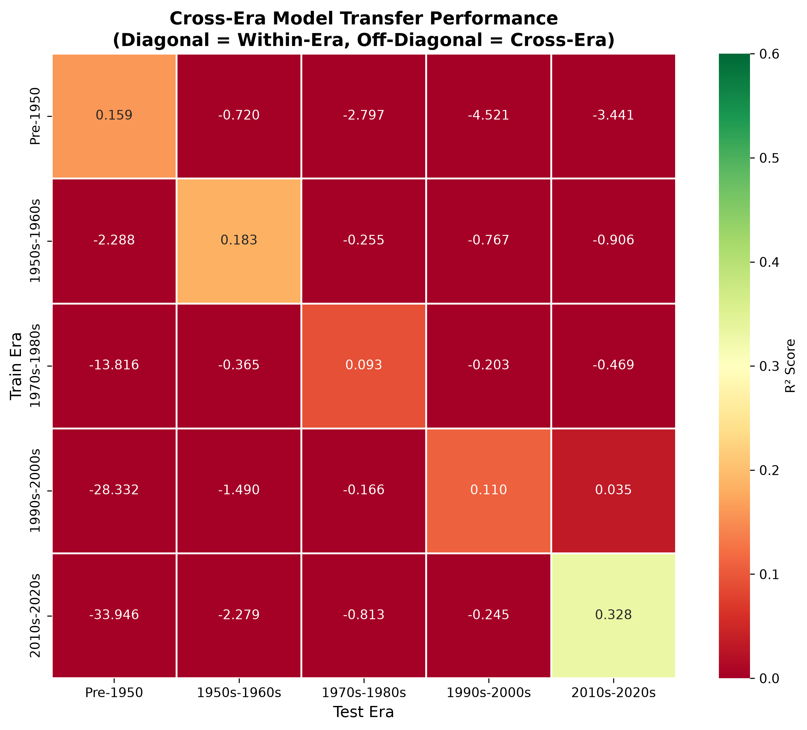
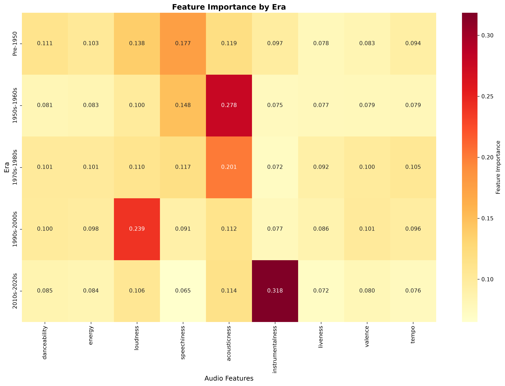

# Era Bias in Music Popularity Prediction

**Authors:** Avery Mattoon, Leila Buchan

Can a model trained on a song's audio features predict its popularity, and does that model work equally well for music from every era? We train machine learning models on 580K+ Spotify tracks released from 1921 to 2020 and test how well they transfer across five musical eras.

## Key findings

1. **Audio features predict popularity only weakly within an era.** A Random Forest trained and tested within a single era explains between 9% and 33% of the variance in popularity (held-out R² of 0.09 to 0.33).
2. **Models do not transfer across eras.** A model trained on one era and applied to another does worse than simply predicting that era's average popularity. Every off-diagonal R² is negative except one, which is essentially zero.
3. **Pooled models mostly learn the era.** Trained on all eras together, Random Forest reaches a test R² of 0.34, higher than most of the within-era scores. Average popularity differs sharply by era, and some audio features (such as acousticness) track recording era, so much of the pooled model's accuracy comes from placing a song in its era rather than ranking songs within it.
4. **What predicts popularity changes over time.** The most important audio feature shifts from speechiness (before 1950) to acousticness (1950s–80s), loudness (1990s–2000s) and instrumentalness (2010s–20s).

For a recommendation system, this means one popularity model trained on recent music should not be assumed to treat older catalogs fairly.

## Results

### Cross-era transfer

Each row is a model trained on one era. Each column is the held-out test set of one era. Diagonal = within-era performance. Off-diagonal = cross-era transfer.



| Train era \ Test era | Pre-1950 | 1950s–60s | 1970s–80s | 1990s–2000s | 2010s–20s |
|---|---|---|---|---|---|
| **Pre-1950** | **0.159** | −0.720 | −2.797 | −4.521 | −3.441 |
| **1950s–60s** | −2.288 | **0.183** | −0.255 | −0.767 | −0.906 |
| **1970s–80s** | −13.816 | −0.365 | **0.093** | −0.203 | −0.469 |
| **1990s–2000s** | −28.332 | −1.490 | −0.166 | **0.110** | 0.035 |
| **2010s–20s** | −33.946 | −2.279 | −0.813 | −0.245 | **0.328** |

The very large negative values in the Pre-1950 column are partly a scale effect. Pre-1950 tracks have almost uniformly low popularity (within-era RMSE of 4.5 points, versus 11–17 for other eras). With so little variance to explain, any model trained on another era's popularity levels produces a strongly negative R² there.

### Within-era performance

| Era | Tracks | Held-out R² | RMSE (popularity points) |
|---|---|---|---|
| Pre-1950 | 38,689 | 0.159 | 4.55 |
| 1950s–60s | 82,640 | 0.183 | 11.46 |
| 1970s–80s | 144,163 | 0.093 | 12.63 |
| 1990s–2000s | 195,716 | 0.110 | 13.36 |
| 2010s–20s | 119,182 | 0.328 | 16.59 |

### Feature importance by era



### Model comparison (all eras pooled)

| Model | Test R² | Test RMSE | Train − test R² |
|---|---|---|---|
| Linear Regression | 0.213 | 16.12 | 0.002 |
| Ridge Regression | 0.213 | 16.12 | 0.002 |
| Lasso Regression | 0.212 | 16.13 | 0.002 |
| Decision Tree | 0.251 | 15.73 | 0.166 |
| K-Nearest Neighbors | 0.270 | 15.52 | 0.138 |
| Gradient Boosting | 0.322 | 14.96 | 0.011 |
| **Random Forest** | **0.340** | **14.77** | 0.128 |

Random Forest had the best test performance and was used for the era analysis. Gradient Boosting came close with much less overfitting, and would be a reasonable alternative.

## Methodology

- **Data:** [Spotify Dataset 1921–2020, 600k+ Tracks](https://www.kaggle.com/datasets/yamaerenay/spotify-dataset-19212020-600k-tracks/data), filtered to tracks with a valid release year from 1921 to 2020 (580,390 tracks).
- **Features:** nine audio features only (danceability, energy, loudness, speechiness, acousticness, instrumentalness, liveness, valence, tempo). Release year and other time-based features are deliberately excluded, so the models cannot see a song's era directly.
- **Eras:** Pre-1950, 1950s–60s, 1970s–80s, 1990s–2000s, 2010s–20s.
- **Evaluation:** each era is split 80/20 into train and test sets. Every cell of the transfer matrix scores a model on the held-out 20% test set of the test era, so no model is ever evaluated on rows it was trained on.

**Correction note:** an earlier version evaluated each model on its own era's full data, including its training rows. That inflated the within-era (diagonal) R² values by roughly 0.15–0.30. The results above use the corrected held-out evaluation. The main conclusion, that models do not transfer across eras, holds under both versions.

## Project structure

```
Spotify-Era-Popularity-Score-Prediction/
├── tracks.csv             # Dataset (~600K x 20, stored with Git LFS)
├── preprocessing.py       # Cleaning, year extraction, era assignment
├── model_selection.py     # Compares 7 regression models on pooled data
├── model_assessment.py    # Per-era Random Forests, transfer matrix, feature importance
└── README.md
```

## Usage

```bash
pip install pandas numpy scikit-learn matplotlib seaborn
python3 preprocessing.py      # writes tracks_cleaned.csv
python3 model_selection.py    # writes model_comparison_detailed.csv, model_comparison.png
python3 model_assessment.py   # writes within_era_performance.csv, cross_era_performance.csv,
                              #        cross_era_transfer_matrix.png, feature_importance_by_era.csv,
                              #        feature_importance_evolution.png
```

## Limitations

- Spotify popularity reflects current listening, not historical success, so older tracks are rated by today's audience.
- Eras are unevenly sized (38K tracks before 1950 versus 196K in the 1990s–2000s).
- Audio features miss much of what drives popularity, such as artist fame, marketing, lyrics and playlist placement.

## References

1. Ferraro, A., Serra, X., & Bauer, C. (2021). Break the Loop: Gender Imbalance in Music Recommenders. *CHIIR '21*.
2. Ferraro, A., Serra, X., & Bauer, C. (2021). What is fair? Exploring the artists' perspective on the fairness of music streaming platforms. *INTERACT 2021*.
3. Ungruh, J., et al. (2024). Putting popularity bias mitigation to the test: A user-centric evaluation in music recommenders. *RecSys '24*.

*Built as a project for a machine learning course at Emory University.*
